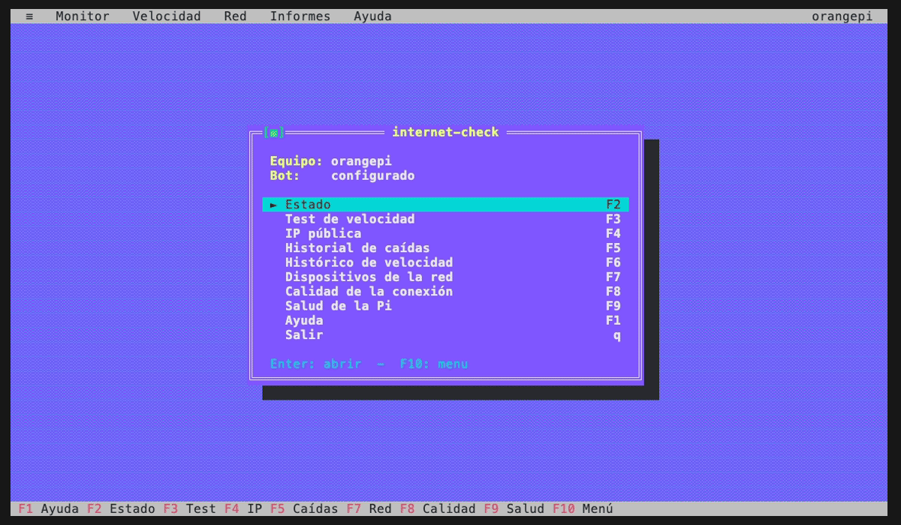

# internet-check

[English](README.md)

Monitor de conexión a Internet para una **Orange Pi Zero 2** (y cualquier Debian con systemd),
controlado por un **bot de Telegram** y por una **TUI** al estilo Turbo Vision.

- Avisa por Telegram cuando vuelve Internet tras un corte, con la hora de la caída y su duración.
- Distingue entre caída de Internet, apagón y reinicio solicitado, y calcula la disponibilidad.
- Bot bidireccional con menú de botones: estado, test de velocidad, IP pública, historiales,
  dispositivos de la red, Wake-on-LAN y reinicio remoto.
- Gráficas PNG, exportación a CSV, aviso de versión nueva y varios usuarios con permisos
  (administradores y solo consulta).
- Calidad de la conexión (latencia, jitter, pérdida y DNS), salud de la Pi (temperatura, memoria,
  disco) e **informes** automáticos diarios y semanales.
- Avisos automáticos: test de velocidad programado, cambio de IP pública, dispositivos nuevos,
  conexión degradada, fallo de DNS y alarmas de salud del equipo.
- Solo **Python 3 estándar**: sin dependencias, sin `pip`, sin root para comprobar la conexión.

> Autor: **Miguel González Oreiro** · Licencia: [GPL-3.0-or-later](LICENSE)

---



## Índice
1. [Instalación](#instalación)
2. [Configuración](#configuración)
3. [Bot de Telegram](#bot-de-telegram)
4. [Avisos automáticos](#avisos-automáticos)
5. [Alarma cuando se cae la conexión (latido)](#alarma-cuando-se-cae-la-conexión-latido)
6. [TUI](#tui)
7. [Cómo funciona](#cómo-funciona)
8. [Privacidad y seguridad](#privacidad-y-seguridad)
9. [Desarrollo](#desarrollo)
10. [Licencia y créditos](#licencia-y-créditos)

---

## Instalación

**Requisitos:** Debian, Armbian u otra distribución con `systemd` y Python 3.7 o superior
(probado en Orange Pi Zero 2 con Debian 12 y Python 3.11).

### 1. Crear el bot de Telegram
1. En Telegram habla con **@BotFather** → `/newbot` y copia el token.
2. Escribe cualquier mensaje a tu bot nuevo.
3. Abre `https://api.telegram.org/bot<TOKEN>/getUpdates` y copia el valor de `chat.id`.

### 2. Generar e instalar el paquete
El paquete se genera en cualquier máquina, también macOS (no necesita `dpkg-deb`):

```bash
./build-deb.sh 1.7.1
scp internet-check_1.7.1_all.deb usuario@orangepi:
```

En la Orange Pi:

```bash
sudo apt install ./internet-check_1.7.1_all.deb
sudo nano /etc/internet-check/bot.env      # token y chat id
sudo systemctl restart internet-check
journalctl -u internet-check -f
```

El instalador crea las configuraciones la primera vez y **nunca las sobrescribe** al actualizar.
Si vienes de una versión anterior a la 1.3 (con el token en `config.env`), las credenciales se
mueven solas a `bot.env`.

- Desinstalar: `sudo apt remove internet-check` (`purge` borra además configuración y datos).
- Probar: desconecta el cable de red un minuto y vuelve a conectarlo; llegará el aviso.

---

## Configuración

Hay **dos ficheros** en `/etc/internet-check/`:

| Fichero | Contenido | Permisos |
|---|---|---|
| `bot.env` | Credenciales del bot (`TELEGRAM_TOKEN`, `TELEGRAM_CHAT_ID`) | 600, solo root |
| `config.env` | Todos los demás ajustes (sin secretos) | 644 |

Tras cambiar cualquiera: `sudo systemctl restart internet-check`. Las plantillas con todos los
ajustes comentados están en `/usr/share/internet-check/`.

### Ajustes de `config.env`

| Variable | Por defecto | Descripción |
|---|---|---|
| `DEVICE_NAME` | nombre del equipo | Nombre que aparece en los mensajes |
| `CHECK_INTERVAL` | `10` | Segundos entre comprobaciones de conexión |
| `FAIL_THRESHOLD` | `3` | Fallos seguidos para dar la conexión por caída |
| `CHECK_HOSTS` | `1.1.1.1:53,8.8.8.8:53,9.9.9.9:53` | Destinos TCP de la comprobación |
| `CHECK_TIMEOUT` | `3` | Segundos de espera por destino |
| `SPEEDTEST_SERVERS` | Clouvider (Fráncfort, Londres, Ámsterdam) | Backends LibreSpeed (`https://…/backend`), por orden |
| `SPEEDTEST_SECONDS` | `8` | Duración de la bajada y de la subida |
| `SPEEDTEST_STREAMS` | `4` | Conexiones paralelas del test |
| `SPEEDTEST_EVERY_HOURS` | `6` | Test programado; `0` lo desactiva |
| `SPEED_MIN_DOWN_MBPS` | `0` | Avisa si la bajada queda por debajo; `0` = sin aviso |
| `IP_CHECK_MINUTES` | `5` | Vigila cambios de IP pública; `0` lo desactiva |
| `LAN_SCAN_MINUTES` | `10` | Busca dispositivos nuevos; `0` lo desactiva |
| `LAN_CIDR` | /24 de la interfaz principal | Red a escanear (máximo 1024 direcciones) |
| `WOL_DEVICES` | vacío | Equipos para Wake-on-LAN: `PC=AA:BB:CC:DD:EE:FF,NAS=11:22:…` |
| `WOL_BROADCAST` | `255.255.255.255` | Dirección de difusión del paquete mágico |
| `REBOOT_ENABLED` | `1` | Permite reiniciar desde el bot; `0` lo desactiva |
| `QUALITY_INTERVAL` | `60` | Segundos entre medidas de calidad; `0` las desactiva |
| `QUALITY_PROBES` | `10` | Conexiones de prueba por medida |
| `QUALITY_LOSS_ALERT` | `10` | % de pérdida que se considera conexión degradada |
| `QUALITY_RTT_ALERT` | `300` | ms de latencia que se considera conexión degradada |
| `QUALITY_ALERT_BURSTS` | `3` | Medidas seguidas para avisar (y para dar la conexión por recuperada) |
| `HEALTH_MINUTES` | `5` | Minutos entre lecturas de salud; `0` las desactiva |
| `HEALTH_TEMP_ALERT` | `75` | °C de CPU a partir de los que se avisa |
| `HEALTH_DISK_ALERT` | `90` | % de disco usado a partir del que se avisa |
| `HEALTH_MEM_ALERT` | `90` | % de memoria usada a partir del que se avisa |
| `RETENTION_DAYS` | `30` | Días que se conservan las medidas de calidad y salud |
| `REPORT_DAILY_TIME` | `08:00` | Hora del informe diario, **hora local de la Pi**; `off` lo desactiva |
| `REPORT_WEEKLY_DAY` | `mon` | Día en que el informe diario pasa a ser semanal (`mon`…`sun`); `off` = nunca |
| `UPDATE_CHECK_HOURS` | `24` | Cada cuántas horas busca una versión nueva en GitHub; `0` lo desactiva |
| `UPDATE_REPO` | el del proyecto | Repositorio de GitHub donde buscar las releases (`propietario/repositorio`) |
| `WATCH_TARGETS` | vacío | Equipos y servicios a vigilar: `Nombre=destino,Otro=destino` (ver más abajo) |
| `WATCH_INTERVAL` | `60` | Segundos entre comprobaciones de los servicios vigilados |
| `WATCH_FAILS` | `3` | Fallos seguidos para dar un servicio por caído |
| `PRESENCE_MISSES` | `3` | Escaneos seguidos sin ver un dispositivo vigilado para darlo por fuera |
| `QUIET_HOURS` | `off` | Horario del modo no molestar, `23:00-07:00` (puede cruzar la medianoche) |
| `HEARTBEAT_URL` | vacío | URL del servicio de latido que da la alarma de caída (ver más abajo) |
| `HEARTBEAT_SECONDS` | `60` | Segundos entre latidos |

> **Zona horaria:** las horas de los mensajes y del informe programado son las del sistema. Muchas
> imágenes de Orange Pi vienen en UTC; ajústala con `sudo timedatectl set-timezone Europe/Madrid`.

Para uso avanzado: `STATE_FILE`, `DB_FILE`, `OUI_FILE`, `INTERNET_CHECK_CONFIG` e
`INTERNET_CHECK_BOT_CONFIG` cambian las rutas de los ficheros de datos y configuración.

---

## Bot de Telegram

Escribe `/menu` (o cualquier texto) y aparece el menú con botones. También hay comandos:

| Botón | Comando | Qué hace |
|---|---|---|
| 📊 Estado | `/estado` | Conexión actual, última caída, disponibilidad 24 h / 7 d, uptime, IP y último test |
| 🚀 Test velocidad | `/velocidad` | Mide latencia, bajada y subida (~20 s) y lo guarda en el histórico |
| 🌍 IP pública | `/ip` | IP pública actual |
| 📉 Caídas | `/caidas` | Últimas caídas (internet, apagón o reinicio) y disponibilidad 24 h / 7 d / 30 d |
| 📈 Velocidad (histórico) | `/historico` | Mini-gráfica de tendencia, medias y últimos tests |
| 📶 Calidad | `/calidad` | Latencia, jitter, pérdida y DNS: última hora, 24 h y gráfica por hora |
| 🩺 Salud | `/salud` | Temperatura de CPU, carga, memoria, disco y tamaño de la base de datos |
| 🖼️ Gráficas | `/graficas` | Imagen PNG de latencia (24 h), pérdida (24 h), velocidad (7 días) o temperatura y memoria (24 h) |
| 📰 Informe | `/informe` | Resumen de las últimas 24 h, la semana o el mes |
| 📤 Exportar | `/exportar` | Zip con CSV de caídas, velocidad, calidad y salud (7 días, 30 días o todo) |
| 🔎 Actualización | `/actualizar` | Busca una versión nueva en GitHub y explica cómo instalarla |
| 👁️ Vigilancia | `/vigilancia` | Estado y disponibilidad de los servicios vigilados (NAS, router, webs…) |
| 🏠 Presencia | `/presencia [nombre]` | Quién está en casa; con un nombre, vigila o deja de vigilar a ese dispositivo (admin) |
| 🏷️ Nombrar | `/nombrar <IP o MAC> <nombre>` | Pone nombre a un dispositivo; sin nombre, lo borra (admin) |
| 🌙 No molestar | `/silencio [horas\|off]` | Retiene los avisos poco urgentes durante unas horas (admin) |
| 💓 Latido | `/latido [prueba\|pausa [min]\|reanudar]` | Estado del latido de la alarma de caída, envío de prueba y pausa para probar la alarma (admin) |
| ❓ Ayuda | `/ayuda` | Lista de comandos y de avisos automáticos |
| ℹ️ Acerca de | `/acerca` | Versión, autor, licencia y repositorio |
| 📡 Dispositivos | `/dispositivos` | Escanea la red: IP, fabricante, MAC, nombre NetBIOS y DNS; marca los nuevos con 🆕 |
| 💡 Encender equipo | `/encender` | Envía un paquete Wake-on-LAN al equipo elegido |
| 🔄 Reiniciar | `/reiniciar` | Reinicia la Orange Pi tras una confirmación que caduca a los 60 s |

### Usuarios autorizados
El bot solo responde a los chats que aparecen en `bot.env`; cualquier otro se ignora y queda
anotado en el log. Cada respuesta va al chat que la pidió.

| Variable | Rol | Permisos |
|---|---|---|
| `TELEGRAM_CHAT_ID` | Administrador principal | Todo, y recibe todos los avisos |
| `TELEGRAM_ADMINS` | Administradores adicionales | Todo |
| `TELEGRAM_VIEWERS` | Espectadores | Solo consulta: sin **Encender equipo** ni **Reiniciar** |

Son listas de ids de chat separados por comas. Un **grupo** también vale (su id es negativo): todos
sus miembros tienen el rol del grupo. Con `TELEGRAM_NOTIFY_VIEWERS=1`, los avisos importantes
(caída y recuperación, reinicio, conexión degradada, fallo de DNS) se copian también a los
espectadores. Para conocer el id de un chat, escribe al bot y consulta
`https://api.telegram.org/bot<TOKEN>/getUpdates`.

### Vigilar equipos y servicios
Define en `config.env` lo que quieres vigilar, como `Nombre=destino` separados por comas:

```
WATCH_TARGETS=NAS=192.168.1.50:5000,Router=ping://192.168.1.1,Web=https://example.com
```

| Destino | Cómo se comprueba |
|---|---|
| `host:puerto` o `tcp://host:puerto` | Conexión TCP |
| `ping://host` | `ping` del sistema (si está instalado) |
| `http://…` / `https://…` | Petición GET; falla con error de red o código ≥ 400 (los 401 y 403 cuentan como «responde») |

Tras `WATCH_FAILS` fallos seguidos (3 por defecto) avisa de la caída, y al recuperarse avisa con su
duración. Estos avisos **llegan siempre**, también en modo no molestar. Los destinos que no son de la
red local no se comprueban mientras no hay Internet, para no dar falsas alarmas. La disponibilidad de
cada servicio aparece en `/vigilancia` y en los informes. Las URL pueden llevar parámetros secretos:
en los mensajes solo se muestra el nombre del servidor.

### Nombres y presencia de dispositivos
- **`/nombrar 192.168.1.20 Móvil de Ana`** guarda un nombre (hasta 40 caracteres) que sustituye al
  nombre técnico en las listas, avisos e informes. Admite IP, MAC completa o parte del nombre.
- **`/presencia Ana`** activa o desactiva el aviso de llegada y salida de ese dispositivo
  («🏠 Ana ha llegado a casa», «🚪 Ana se ha ido»). Se da por fuera tras `PRESENCE_MISSES` escaneos
  seguidos sin verlo (unos 30 min por defecto). Algunos móviles duermen el wifi y pueden aparecer
  fuera estando en casa; ajusta `PRESENCE_MISSES` si te molesta.

### Modo no molestar
Con `QUIET_HOURS=23:00-07:00` (horario fijo) o `/silencio 8` (manual, 8 horas), los avisos poco
urgentes —dispositivos nuevos, velocidad baja, degradación, DNS, temperatura/disco/memoria, cambio de
IP, llegadas y salidas— **se retienen y se entregan juntos en un resumen** al terminar. El informe
programado y el aviso de versión nueva esperan a que termine. **Siguen llegando siempre** las caídas de
Internet, los reinicios y las caídas de servicios vigilados.

### Gráficas, exportación y versión nueva
- **Gráficas:** imágenes PNG dibujadas por el propio programa, sin librerías externas.
- **Exportar:** un `.zip` con `caidas.csv`, `velocidad.csv`, `calidad.csv` y `salud.csv` (UTF-8
  con BOM, para que Excel respete los acentos) y un `LEEME.txt`. La calidad y la salud solo existen
  durante `RETENTION_DAYS`.
- **Actualización:** consulta la última release de GitHub y avisa una sola vez de cada versión
  nueva (`UPDATE_CHECK_HOURS`). **Nunca instala nada por su cuenta**: te da el comando para hacerlo.

### Dispositivos: fabricante y nombres
- **Fabricante:** búsqueda por MAC en la base del IEEE (MA-L, MA-M y MA-S, unas 54.000 entradas).
  Los móviles con MAC aleatoria salen como «MAC privada (aleatoria)», porque esa MAC no
  identifica al fabricante.
- **NetBIOS:** consulta `NBSTAT` por UDP 137; responden Windows, Samba y muchas impresoras y NAS.
- **DNS:** nombre inverso, si el router lo publica.

### Wake-on-LAN
Define los equipos en `config.env`:

```
WOL_DEVICES=PC=AA:BB:CC:DD:EE:FF,NAS=11:22:33:44:55:66
```

El botón 💡 mostrará un botón por equipo. El equipo debe tener Wake-on-LAN activado y estar en
la misma red.

### Reinicio remoto
El botón 🔄 pregunta «¿Reiniciar?» con ✅ / ❌. Al volver, el bot avisa con el tiempo que tardó y
el reinicio queda en el historial de caídas con su propio icono (no cuenta como apagón).

---

## Avisos automáticos

- **Internet recuperado**, con hora de caída y duración.
- **Reinicio tras apagón**: si la Pi arranca y el último latido es antiguo, avisa de cuánto estuvo
  sin servicio. Una parada limpia (`apt`, `systemctl stop`) no se confunde con un apagón.
- **Test de velocidad programado** cada `SPEEDTEST_EVERY_HOURS`. Con `SPEED_MIN_DOWN_MBPS` avisa
  si la bajada queda por debajo del umbral.
- **Cambio de IP pública**, comprobada cada `IP_CHECK_MINUTES`.
- **Dispositivo nuevo en la red**, con escaneo cada `LAN_SCAN_MINUTES`. La primera pasada solo
  memoriza lo que hay, sin avisar.
- **Conexión degradada**: si la pérdida o la latencia superan los umbrales durante varias medidas
  seguidas, avisa; otro aviso indica cuándo se estabiliza. Un corte total no cuenta como
  degradación (lo gestiona el aviso de caída).
- **DNS caído**: avisa si hay Internet pero el resolutor del sistema no responde.
- **Salud del equipo**: avisa una vez al superar el umbral de temperatura, disco o memoria, y otra
  al normalizarse.
- **Informe programado** a `REPORT_DAILY_TIME`: diario, y semanal el día `REPORT_WEEKLY_DAY`.
  Resume disponibilidad, caídas, velocidad, calidad, estado del equipo y dispositivos nuevos. Si la
  Pi estaba apagada a esa hora, se envía al arrancar.

---

## Alarma cuando se cae la conexión (latido)

El aviso de «Internet recuperado» llega al volver la conexión, porque **con Internet cortado la Pi no
puede escribir a Telegram**. Para tener una alarma *mientras* está caída hay que darle la vuelta: la Pi
avisa cada minuto a un servicio externo (un «latido») y es ese servicio quien manda la alarma a
Telegram cuando los latidos dejan de llegar. También avisa si la Pi se apaga o se cuelga.

Con [Healthchecks.io](https://healthchecks.io) (gratuito, de código abierto):
1. Crea una cuenta y un *check* nuevo con periodo de **1 minuto** y margen (*grace time*) de **2–3 minutos**.
   Ese margen es el retraso tras el que salta la alarma.
2. En *Integrations*, añade **Telegram** y asígnalo al check.
3. Copia la *ping URL* del check y ponla en `config.env`:
   ```
   HEARTBEAT_URL=https://hc-ping.com/tu-codigo-secreto
   ```
4. `sudo systemctl restart internet-check`.

También sirve cualquier servicio que reciba una petición GET periódica, como un monitor de tipo
*Push* de Uptime Kuma. La URL lleva un código secreto: no se escribe nunca en los logs. `/estado`
muestra si el latido se está entregando.

**Probar la alarma sin tocar cables:** escribe `/latido pausa 5` al bot. Los latidos se detienen
5 minutos (máximo 60; se reanudan solos, o antes con `/latido reanudar`) y, pasado el margen que
configuraste en el servicio, te llegará su alarma por Telegram. `/latido prueba` envía un latido
suelto y dice si se entregó. La pausa solo vive en memoria: un reinicio del servicio la cancela.

## TUI

```bash
internet-check-tui
```

Interfaz de terminal al estilo **Turbo Vision**: escritorio sombreado, barra de menú con
desplegables, ventanas con borde doble y sombra, diálogos con botón y barra de estado.

| Tecla | Acción |
|---|---|
| `F10` | Menú (`←` `→` entre menús, `↑` `↓` opciones, `Enter` elegir, `Esc` cerrar) |
| `F1` | Ayuda (también en el menú **Ayuda** → *Contenido*, *Teclas y atajos* y *Acerca de…*) |
| `F2` / `F5` / `F6` / `F7` | Estado / historial de caídas / histórico de velocidad / dispositivos |
| `F8` / `F9` | Calidad de la conexión / salud de la Pi |
| `F3` / `F4` | Test de velocidad / IP pública (se envían además al bot) |
| `Enter` | Abre la opción de la lista · `q` o `Esc` sale |

El menú **Informes** abre el resumen diario, semanal o mensual y exporta el histórico a CSV (se envía
al bot, o se guarda en la carpeta actual si no hay bot). **Ayuda → Buscar actualización** consulta
GitHub. El lanzador se relanza con `sudo` para poder leer `bot.env`.

---

## Cómo funciona

- **Detección:** cada `CHECK_INTERVAL` segundos abre una conexión TCP a los destinos de
  `CHECK_HOSTS`. Tras `FAIL_THRESHOLD` fallos seguidos da la conexión por caída y, al volver,
  avisa. Si Telegram no responde al recuperar, reintenta cada 15 s hasta enviarlo.
- **Calidad:** cada `QUALITY_INTERVAL` s lanza una ráfaga de `QUALITY_PROBES` conexiones TCP y mide
  latencia, jitter y pérdida, y comprueba que el DNS resuelve. Los resultados se guardan para los
  informes y alimentan los avisos de degradación.
- **Datos:** caídas, tests de velocidad, calidad, salud y dispositivos se guardan en SQLite
  (`/var/lib/internet-check/data.db`).
- **Disponibilidad:** se calcula sobre la ventana pedida, acotada al inicio de la monitorización.

Detalles de módulos, hilos y esquema de datos en [docs/arquitectura.md](docs/arquitectura.md).

---

## Privacidad y seguridad

- El token vive en `bot.env` (600, solo root) y nunca aparece en logs ni en `config.env`.
- El bot ignora cualquier chat distinto de `TELEGRAM_CHAT_ID`. El reinicio exige confirmación con
  caducidad, de modo que un botón antiguo no puede reiniciar el equipo.
- El servicio se ejecuta como root (necesario para reiniciar el sistema). Si no quieres esa
  función, pon `REBOOT_ENABLED=0`.
- **Servicios de terceros contactados**, sin telemetría de ningún tipo:
  - Telegram (`api.telegram.org`): mensajes del bot.
  - `api.ipify.org`, `ifconfig.me`, `icanhazip.com`: para conocer la IP pública.
  - Servidores LibreSpeed de Clouvider: solo durante el test de velocidad.
  - El servicio de latido que elijas (`HEARTBEAT_URL`): recibe una petición por minuto; es opcional.
  - `api.github.com`: para buscar versiones nuevas; solo se envía una petición anónima de lectura
    (sin datos tuyos ni de la instalación). Se desactiva con `UPDATE_CHECK_HOURS=0`.
- El escaneo de la red es local (ARP, NetBIOS y DNS inverso) y sus resultados no salen de la Pi,
  salvo lo que tú pidas al bot.

---

## Desarrollo

Sin dependencias: basta Python 3.7+.

```bash
# Demonio y bot, con datos en una carpeta temporal
export TELEGRAM_TOKEN=... TELEGRAM_CHAT_ID=... DB_FILE=/tmp/ic/data.db STATE_FILE=/tmp/ic/state.json
python3 monitor.py

# TUI (lee bot.env y config.env, o las variables de entorno)
python3 tui.py

# Paquete .deb
./build-deb.sh 1.7.1

# Regenerar la base de fabricantes con los CSV del IEEE
python3 -I tools/build_oui.py <carpeta con oui.csv, mam.csv y oui36.csv>
```

| Archivo | Función |
|---|---|
| `monitor.py` | Demonio: detección de caídas y arranque del bot y las tareas |
| `bot.py` | Bot de Telegram: menú, acciones y reinicio |
| `jobs.py` | Tareas periódicas: test programado, IP y dispositivos |
| `reports.py` | Textos de estado, historiales, calidad, salud e informes |
| `common.py` | Configuración, Telegram, IP pública y test de velocidad |
| `metrics.py` | Calidad de la conexión (latencia, jitter, pérdida, DNS) y salud de la Pi |
| `info.py` | Textos de ayuda y «acerca de» (versión, autor, licencia) de la TUI y del bot |
| `charts.py` | Gráficas PNG sin dependencias (lienzo, fuente de bitmap y codificador PNG) |
| `export.py` | Exportación del histórico a CSV dentro de un zip |
| `updates.py` | Búsqueda de versiones nuevas en las releases de GitHub |
| `watch.py` | Vigilancia de equipos y servicios propios (TCP, ping, HTTP) |
| `quiet.py` | Modo no molestar: retención de avisos y resumen final |
| `heartbeat.py` | Latido a un servicio externo para la alarma de caída |
| `lan.py` | Escaneo de red, fabricantes, NetBIOS y Wake-on-LAN |
| `db.py` | Almacenamiento SQLite |
| `tui.py` | Interfaz Turbo Vision |
| `build-deb.sh`, `packaging/` | Generación del paquete Debian |

---

## Licencia y créditos

Copyright © 2026 Miguel González Oreiro <mgoreiro@gmail.com>

Este programa es software libre: puedes redistribuirlo y modificarlo bajo los términos de la
**GNU General Public License** publicada por la Free Software Foundation, ya sea la versión 3 o
(a tu elección) cualquier versión posterior. Se distribuye **sin ninguna garantía**; consulta el
fichero [LICENSE](LICENSE) para más detalles.

Créditos de terceros:
- `data/oui.txt.gz` se deriva de los listados públicos de asignación de direcciones MAC del
  [IEEE Registration Authority](https://standards.ieee.org/products-services/regauth/). Los nombres
  de fabricante pertenecen a sus titulares; este fichero no está cubierto por el copyright del
  proyecto.
- Test de velocidad: protocolo y servidores [LibreSpeed](https://librespeed.org), alojados por
  Clouvider.
- La interfaz de la TUI se inspira en Turbo Vision de Borland.
