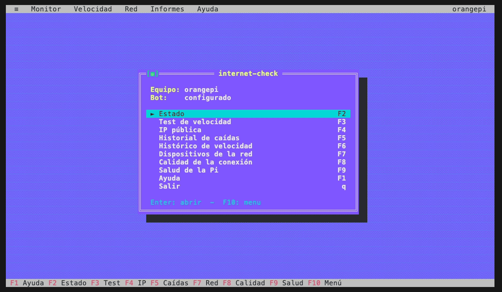

# internet-check

[Español](README.es.md)

An Internet-connection monitor for an **Orange Pi Zero 2** (and any Debian with systemd), controlled by a
**Telegram bot** and by a **TUI** in the style of Turbo Vision.

- Tells you on Telegram when the Internet comes back after an outage, with the time it went down and how long it lasted.
- Tells an Internet outage, a power cut and a requested reboot apart, and works out availability.
- Two-way bot with a button menu: status, speed test, public IP, histories, devices on the network,
  Wake-on-LAN and remote reboot.
- PNG charts, CSV export, new-version notice and several users with permissions
  (administrators and read-only).
- Connection quality (latency, jitter, loss and DNS), Pi health (temperature, memory,
  disk) and automatic daily and weekly **reports**.
- Automatic alerts: scheduled speed test, public IP change, new devices,
  degraded connection, DNS failure and device health alarms.
- **Standard-library Python 3 only**: no dependencies, no `pip`, no root needed to check the connection.

> The bot's menu, commands and messages, and the TUI, are in Spanish for now. This README keeps the command names as they are in the bot.

> Author: **Miguel González Oreiro** · License: [GPL-3.0-or-later](LICENSE)

---



## Contents
1. [Install](#install)
2. [Configuration](#configuration)
3. [Telegram bot](#telegram-bot)
4. [Automatic alerts](#automatic-alerts)
5. [Alarm while the connection is down (heartbeat)](#alarm-while-the-connection-is-down-heartbeat)
6. [TUI](#tui)
7. [How it works](#how-it-works)
8. [Privacy and security](#privacy-and-security)
9. [Development](#development)
10. [License and credits](#license-and-credits)

---

## Install

**Requirements:** Debian, Armbian or another distribution with `systemd` and Python 3.7 or later
(tested on an Orange Pi Zero 2 with Debian 12 and Python 3.11).

### 1. Create the Telegram bot
1. In Telegram talk to **@BotFather** → `/newbot` and copy the token.
2. Send any message to your new bot.
3. Open `https://api.telegram.org/bot<TOKEN>/getUpdates` and copy the value of `chat.id`.

### 2. Build and install the package
The package can be built on any machine, macOS included (it does not need `dpkg-deb`):

```bash
./build-deb.sh 1.7.1
scp internet-check_1.7.1_all.deb user@orangepi:
```

On the Orange Pi:

```bash
sudo apt install ./internet-check_1.7.1_all.deb
sudo nano /etc/internet-check/bot.env      # token and chat id
sudo systemctl restart internet-check
journalctl -u internet-check -f
```

The installer creates the configuration files the first time and **never overwrites them** on upgrade.
If you come from a version older than 1.3 (with the token in `config.env`), the credentials
move to `bot.env` by themselves.

- Uninstall: `sudo apt remove internet-check` (`purge` also deletes configuration and data).
- Test it: unplug the network cable for a minute and plug it back in; the alert will arrive.

---

## Configuration

There are **two files** in `/etc/internet-check/`:

| File | Contents | Permissions |
|---|---|---|
| `bot.env` | Bot credentials (`TELEGRAM_TOKEN`, `TELEGRAM_CHAT_ID`) | 600, root only |
| `config.env` | All other settings (no secrets) | 644 |

After changing either: `sudo systemctl restart internet-check`. Templates with every
setting commented are in `/usr/share/internet-check/`.

### `config.env` settings

| Variable | Default | Description |
|---|---|---|
| `DEVICE_NAME` | the machine's name | Name shown in the messages |
| `CHECK_INTERVAL` | `10` | Seconds between connection checks |
| `FAIL_THRESHOLD` | `3` | Consecutive failures before the connection counts as down |
| `CHECK_HOSTS` | `1.1.1.1:53,8.8.8.8:53,9.9.9.9:53` | TCP targets of the check |
| `CHECK_TIMEOUT` | `3` | Seconds to wait per target |
| `SPEEDTEST_SERVERS` | Clouvider (Frankfurt, London, Amsterdam) | LibreSpeed backends (`https://…/backend`), in order |
| `SPEEDTEST_SECONDS` | `8` | Duration of the download and of the upload |
| `SPEEDTEST_STREAMS` | `4` | Parallel connections of the test |
| `SPEEDTEST_EVERY_HOURS` | `6` | Scheduled test; `0` disables it |
| `SPEED_MIN_DOWN_MBPS` | `0` | Alerts if the download falls below this; `0` = no alert |
| `IP_CHECK_MINUTES` | `5` | Watches for public IP changes; `0` disables it |
| `LAN_SCAN_MINUTES` | `10` | Looks for new devices; `0` disables it |
| `LAN_CIDR` | /24 of the main interface | Network to scan (at most 1024 addresses) |
| `WOL_DEVICES` | empty | Machines for Wake-on-LAN: `PC=AA:BB:CC:DD:EE:FF,NAS=11:22:…` |
| `WOL_BROADCAST` | `255.255.255.255` | Broadcast address of the magic packet |
| `REBOOT_ENABLED` | `1` | Allows rebooting from the bot; `0` disables it |
| `QUALITY_INTERVAL` | `60` | Seconds between quality measurements; `0` disables them |
| `QUALITY_PROBES` | `10` | Test connections per measurement |
| `QUALITY_LOSS_ALERT` | `10` | Loss % that counts as a degraded connection |
| `QUALITY_RTT_ALERT` | `300` | Latency in ms that counts as a degraded connection |
| `QUALITY_ALERT_BURSTS` | `3` | Consecutive measurements to alert (and to call the connection recovered) |
| `HEALTH_MINUTES` | `5` | Minutes between health readings; `0` disables them |
| `HEALTH_TEMP_ALERT` | `75` | CPU °C above which it alerts |
| `HEALTH_DISK_ALERT` | `90` | Disk usage % above which it alerts |
| `HEALTH_MEM_ALERT` | `90` | Memory usage % above which it alerts |
| `RETENTION_DAYS` | `30` | Days the quality and health measurements are kept |
| `REPORT_DAILY_TIME` | `08:00` | Time of the daily report, **the Pi's local time**; `off` disables it |
| `REPORT_WEEKLY_DAY` | `mon` | Day on which the daily report becomes weekly (`mon`…`sun`); `off` = never |
| `UPDATE_CHECK_HOURS` | `24` | Hours between looks for a new version on GitHub; `0` disables it |
| `UPDATE_REPO` | the project's | GitHub repository to look for releases (`owner/repository`) |
| `WATCH_TARGETS` | empty | Machines and services to watch: `Name=target,Other=target` (see below) |
| `WATCH_INTERVAL` | `60` | Seconds between checks of the watched services |
| `WATCH_FAILS` | `3` | Consecutive failures before a service counts as down |
| `PRESENCE_MISSES` | `3` | Consecutive scans without seeing a watched device before it counts as away |
| `QUIET_HOURS` | `off` | Do-not-disturb schedule, `23:00-07:00` (may cross midnight) |
| `HEARTBEAT_URL` | empty | URL of the heartbeat service that raises the outage alarm (see below) |
| `HEARTBEAT_SECONDS` | `60` | Seconds between heartbeats |

> **Time zone:** the times in the messages and in the scheduled report are the system's. Many
> Orange Pi images ship in UTC; set yours with `sudo timedatectl set-timezone Europe/Madrid`.

For advanced use: `STATE_FILE`, `DB_FILE`, `OUI_FILE`, `INTERNET_CHECK_CONFIG` and
`INTERNET_CHECK_BOT_CONFIG` change the paths of the data and configuration files.

---

## Telegram bot

Type `/menu` (or any text) and the button menu appears. There are also commands (the bot's names are in Spanish):

| Button | Command | What it does |
|---|---|---|
| 📊 Status | `/estado` | Current connection, last outage, availability 24 h / 7 d, uptime, IP and last test |
| 🚀 Speed test | `/velocidad` | Measures latency, download and upload (~20 s) and stores it in the history |
| 🌍 Public IP | `/ip` | Current public IP |
| 📉 Outages | `/caidas` | Latest outages (Internet, power cut or reboot) and availability 24 h / 7 d / 30 d |
| 📈 Speed (history) | `/historico` | Mini trend chart, averages and latest tests |
| 📶 Quality | `/calidad` | Latency, jitter, loss and DNS: last hour, 24 h and an hourly chart |
| 🩺 Health | `/salud` | CPU temperature, load, memory, disk and database size |
| 🖼️ Charts | `/graficas` | PNG image of latency (24 h), loss (24 h), speed (7 days) or temperature and memory (24 h) |
| 📰 Report | `/informe` | Summary of the last 24 h, the week or the month |
| 📤 Export | `/exportar` | Zip with CSVs of outages, speed, quality and health (7 days, 30 days or all) |
| 🔎 Update | `/actualizar` | Looks for a new version on GitHub and explains how to install it |
| 👁️ Watch | `/vigilancia` | Status and availability of the watched services (NAS, router, websites…) |
| 🏠 Presence | `/presencia [name]` | Who is home; with a name, starts or stops watching that device (admin) |
| 🏷️ Name | `/nombrar <IP or MAC> <name>` | Names a device; without a name, removes it (admin) |
| 🌙 Do not disturb | `/silencio [hours\|off]` | Holds back low-urgency alerts for some hours (admin) |
| 💓 Heartbeat | `/latido [prueba\|pausa [min]\|reanudar]` | Status of the outage-alarm heartbeat, a test send and a pause to test the alarm (admin) |
| ❓ Help | `/ayuda` | List of commands and automatic alerts |
| ℹ️ About | `/acerca` | Version, author, license and repository |
| 📡 Devices | `/dispositivos` | Scans the network: IP, vendor, MAC, NetBIOS and DNS name; marks new ones with 🆕 |
| 💡 Wake a machine | `/encender` | Sends a Wake-on-LAN packet to the chosen machine |
| 🔄 Reboot | `/reiniciar` | Reboots the Orange Pi after a confirmation that expires in 60 s |

### Authorized users
The bot only answers the chats listed in `bot.env`; any other is ignored and written to the log.
Each answer goes to the chat that asked for it.

| Variable | Role | Permissions |
|---|---|---|
| `TELEGRAM_CHAT_ID` | Main administrator | Everything, and receives all alerts |
| `TELEGRAM_ADMINS` | Additional administrators | Everything |
| `TELEGRAM_VIEWERS` | Viewers | Read-only: no **Wake a machine** or **Reboot** |

They are comma-separated lists of chat ids. A **group** also works (its id is negative): all its members
get the group's role. With `TELEGRAM_NOTIFY_VIEWERS=1`, the important alerts (outage and recovery, reboot,
degraded connection, DNS failure) are copied to the viewers as well. To find a chat's id, write to the bot and
check `https://api.telegram.org/bot<TOKEN>/getUpdates`.

### Watching machines and services
Define in `config.env` what you want to watch, as `Name=target` separated by commas:

```
WATCH_TARGETS=NAS=192.168.1.50:5000,Router=ping://192.168.1.1,Web=https://example.com
```

| Target | How it is checked |
|---|---|
| `host:port` or `tcp://host:port` | TCP connection |
| `ping://host` | The system `ping` (if installed) |
| `http://…` / `https://…` | GET request; fails on a network error or a code ≥ 400 (401 and 403 count as "answering") |

After `WATCH_FAILS` consecutive failures (3 by default) it alerts of the outage, and when it recovers it alerts
with the duration. These alerts **always arrive**, also in do-not-disturb mode. Targets outside the local
network are not checked while there is no Internet, to avoid false alarms. The availability of each service
appears in `/vigilancia` and in the reports. URLs may carry secret parameters: only the host name is shown in
messages.

### Device names and presence
- **`/nombrar 192.168.1.20 Ana's phone`** saves a name (up to 40 characters) that replaces the technical
  name in lists, alerts and reports. It accepts an IP, a full MAC or part of the name.
- **`/presencia Ana`** turns on or off the arrival and departure alert for that device
  ("🏠 Ana has arrived home", "🚪 Ana has left"). It counts as away after `PRESENCE_MISSES` consecutive scans
  without seeing it (about 30 min by default). Some phones put wifi to sleep and can show as
  away while at home; adjust `PRESENCE_MISSES` if it bothers you.

### Do-not-disturb mode
With `QUIET_HOURS=23:00-07:00` (fixed schedule) or `/silencio 8` (manual, 8 hours), the low-urgency alerts
(new devices, low speed, degradation, DNS, temperature/disk/memory, IP change, arrivals and departures)
**are held back and delivered together in a summary** when it ends. The scheduled report and the new-version
notice wait until it ends. **Always delivered**: Internet outages, reboots and outages of watched services.

### Charts, export and new version
- **Charts:** PNG images drawn by the program itself, with no external libraries.
- **Export:** a `.zip` with `caidas.csv`, `velocidad.csv`, `calidad.csv` and `salud.csv` (UTF-8
  with BOM, so Excel keeps the accents) and a `LEEME.txt`. Quality and health exist only for
  `RETENTION_DAYS`.
- **Update:** it checks GitHub's latest release and alerts once for each new version
  (`UPDATE_CHECK_HOURS`). It **never installs anything by itself**: it gives you the command to do it.

### Devices: vendor and names
- **Vendor:** a lookup by MAC in the IEEE database (MA-L, MA-M and MA-S, about 54,000 entries).
  Phones with a random MAC show as "Private MAC (random)", because that MAC does not
  identify the manufacturer.
- **NetBIOS:** `NBSTAT` query over UDP 137; Windows, Samba and many printers and NAS answer.
- **DNS:** reverse name, if the router publishes it.

### Wake-on-LAN
Define the machines in `config.env`:

```
WOL_DEVICES=PC=AA:BB:CC:DD:EE:FF,NAS=11:22:33:44:55:66
```

The 💡 button will show one button per machine. The machine must have Wake-on-LAN enabled and be on the
same network.

### Remote reboot
The 🔄 button asks "Reboot?" with ✅ / ❌. When it comes back, the bot reports how long it took and
the reboot is recorded in the outage history with its own icon (it does not count as a power cut).

---

## Automatic alerts

- **Internet recovered**, with the time it went down and the duration.
- **Reboot after a power cut:** if the Pi starts and the last heartbeat is old, it says how long it was
  out of service. A clean stop (`apt`, `systemctl stop`) is not mistaken for a power cut.
- **Scheduled speed test** every `SPEEDTEST_EVERY_HOURS`. With `SPEED_MIN_DOWN_MBPS` it alerts
  if the download falls below the threshold.
- **Public IP change**, checked every `IP_CHECK_MINUTES`.
- **New device on the network**, scanned every `LAN_SCAN_MINUTES`. The first pass only memorizes what is
  there, without alerting.
- **Degraded connection:** if loss or latency exceed the thresholds for several consecutive
  measurements, it alerts; another alert says when it settles. A total outage does not count as
  degradation (the outage alert handles it).
- **DNS down:** it alerts if there is Internet but the system resolver does not answer.
- **Device health:** it alerts once when the temperature, disk or memory threshold is exceeded, and again
  when it returns to normal.
- **Scheduled report** at `REPORT_DAILY_TIME`: daily, and weekly on `REPORT_WEEKLY_DAY`.
  It summarizes availability, outages, speed, quality, device state and new devices. If the
  Pi was off at that time, it is sent on startup.

---

## Alarm while the connection is down (heartbeat)

The "Internet recovered" alert arrives when the connection returns, because **with the Internet down the Pi
cannot write to Telegram**. To get an alarm *while* it is down you have to turn it around: the Pi
pings an external service every minute (a "heartbeat"), and it is that service that sends the alarm to
Telegram when the heartbeats stop arriving. It also alerts if the Pi powers off or hangs.

With [Healthchecks.io](https://healthchecks.io) (free, open source):
1. Create an account and a new *check* with a **1-minute** period and a **2–3 minute** grace time.
   That grace time is the delay after which the alarm fires.
2. In *Integrations*, add **Telegram** and assign it to the check.
3. Copy the check's *ping URL* and put it in `config.env`:
   ```
   HEARTBEAT_URL=https://hc-ping.com/your-secret-code
   ```
4. `sudo systemctl restart internet-check`.

Any service that receives a periodic GET request also works, such as a *Push* monitor in Uptime Kuma. The
URL carries a secret code: it is never written to the logs. `/estado` shows whether the heartbeat is being
delivered.

**Test the alarm without touching cables:** type `/latido pausa 5` to the bot. Heartbeats stop for
5 minutes (maximum 60; they resume on their own, or earlier with `/latido reanudar`) and, after the grace
time you set in the service, its alarm reaches you on Telegram. `/latido prueba` sends a single heartbeat and
says whether it was delivered. The pause lives only in memory: restarting the service cancels it.

## TUI

```bash
internet-check-tui
```

A terminal interface in the **Turbo Vision** style: shaded desktop, menu bar with drop-downs,
double-bordered windows with shadow, dialogs with buttons and a status bar.

| Key | Action |
|---|---|
| `F10` | Menu (`←` `→` between menus, `↑` `↓` options, `Enter` choose, `Esc` close) |
| `F1` | Help (also in the **Ayuda** menu → *Contenido*, *Teclas y atajos* and *Acerca de…*) |
| `F2` / `F5` / `F6` / `F7` | Status / outage history / speed history / devices |
| `F8` / `F9` | Connection quality / Pi health |
| `F3` / `F4` | Speed test / public IP (also sent to the bot) |
| `Enter` | Opens the list option · `q` or `Esc` quits |

The **Informes** menu opens the daily, weekly or monthly summary and exports the history to CSV (sent to
the bot, or saved in the current folder if there is no bot). **Ayuda → Buscar actualización** checks
GitHub. The launcher relaunches itself with `sudo` to be able to read `bot.env`.

---

## How it works

- **Detection:** every `CHECK_INTERVAL` seconds it opens a TCP connection to the `CHECK_HOSTS` targets.
  After `FAIL_THRESHOLD` consecutive failures it counts the connection as down and, when it returns,
  alerts. If Telegram does not answer on recovery, it retries every 15 s until it is sent.
- **Quality:** every `QUALITY_INTERVAL` s it fires a burst of `QUALITY_PROBES` TCP connections and measures
  latency, jitter and loss, and checks that DNS resolves. The results are stored for the
  reports and feed the degradation alerts.
- **Data:** outages, speed tests, quality, health and devices are stored in SQLite
  (`/var/lib/internet-check/data.db`).
- **Availability:** computed over the requested window, bounded by the start of monitoring.

Details of modules, threads and the data schema are in [docs/arquitectura.md](docs/arquitectura.md) (in Spanish).

---

## Privacy and security

- The token lives in `bot.env` (600, root only) and never appears in logs or in `config.env`.
- The bot ignores any chat other than those authorized. The reboot requires a confirmation with an
  expiry, so an old button cannot reboot the machine.
- The service runs as root (needed to reboot the system). If you do not want that
  feature, set `REBOOT_ENABLED=0`.
- **Third-party services contacted**, with no telemetry of any kind:
  - Telegram (`api.telegram.org`): the bot's messages.
  - `api.ipify.org`, `ifconfig.me`, `icanhazip.com`: to learn the public IP.
  - Clouvider's LibreSpeed servers: only during the speed test.
  - The heartbeat service you choose (`HEARTBEAT_URL`): receives one request per minute; it is optional.
  - `api.github.com`: to look for new versions; only an anonymous read request is sent
    (no data about you or the installation). Disable it with `UPDATE_CHECK_HOURS=0`.
- The network scan is local (ARP, NetBIOS and reverse DNS) and its results do not leave the Pi,
  except what you ask the bot for.

---

## Development

No dependencies: Python 3.7+ is enough.

```bash
# Daemon and bot, with data in a temporary folder
export TELEGRAM_TOKEN=... TELEGRAM_CHAT_ID=... DB_FILE=/tmp/ic/data.db STATE_FILE=/tmp/ic/state.json
python3 monitor.py

# TUI (reads bot.env and config.env, or the environment variables)
python3 tui.py

# .deb package
./build-deb.sh 1.7.1

# Regenerate the vendor database from the IEEE CSVs
python3 -I tools/build_oui.py <folder with oui.csv, mam.csv and oui36.csv>
```

| File | Role |
|---|---|
| `monitor.py` | Daemon: outage detection and startup of the bot and the tasks |
| `bot.py` | Telegram bot: menu, actions and reboot |
| `jobs.py` | Periodic tasks: scheduled test, IP and devices |
| `reports.py` | Texts for status, histories, quality, health and reports |
| `common.py` | Configuration, Telegram, public IP and speed test |
| `metrics.py` | Connection quality (latency, jitter, loss, DNS) and Pi health |
| `info.py` | Help and "about" texts (version, author, license) of the TUI and the bot |
| `charts.py` | Dependency-free PNG charts (canvas, bitmap font and PNG encoder) |
| `export.py` | Export of the history to CSV inside a zip |
| `updates.py` | Looking for new versions in GitHub releases |
| `watch.py` | Watching your own machines and services (TCP, ping, HTTP) |
| `quiet.py` | Do-not-disturb mode: holding alerts and the final summary |
| `heartbeat.py` | Heartbeat to an external service for the outage alarm |
| `lan.py` | Network scan, vendors, NetBIOS and Wake-on-LAN |
| `db.py` | SQLite storage |
| `tui.py` | Turbo Vision interface |
| `build-deb.sh`, `packaging/` | Debian package generation |

---

## License and credits

Copyright © 2026 Miguel González Oreiro <mgoreiro@gmail.com>

This program is free software: you can redistribute it and modify it under the terms of the
**GNU General Public License** as published by the Free Software Foundation, either version 3 or
(at your option) any later version. It is distributed **without any warranty**; see the
[LICENSE](LICENSE) file for details.

Third-party credits:
- `data/oui.txt.gz` is derived from the public MAC address assignment listings of the
  [IEEE Registration Authority](https://standards.ieee.org/products-services/regauth/). The vendor names
  belong to their holders; this file is not covered by the project's copyright.
- Speed test: protocol and servers by [LibreSpeed](https://librespeed.org), hosted by
  Clouvider.
- The TUI's look is inspired by Borland's Turbo Vision.
